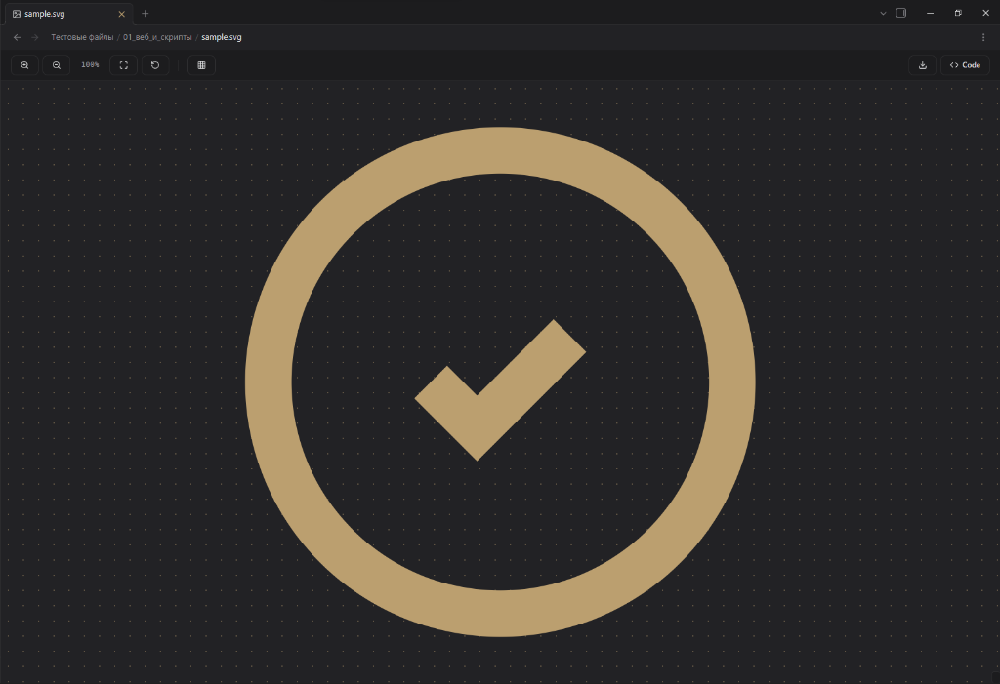
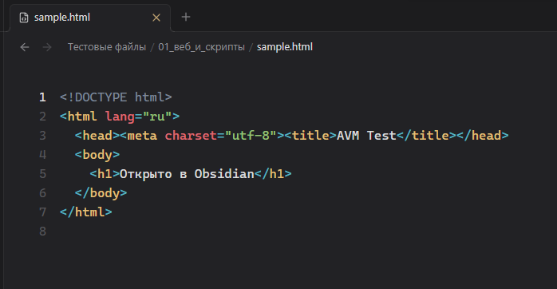

# AVM File Extensions

> Плагин для Obsidian, открывающий поддержку кодовых файлов, конфигураций и векторной графики SVG с нативным редактором CodeMirror 6 и интерактивной векторной студией.

---

## Возможности

- **Редактор кода (CodeMirror 6):** Открытие более 50 форматов без сторонних программ (JS/TS, Python, Go, Rust, C/C++, Shell, SQL, JSON, YAML, TOML, INI, ENV и др.).
- **Интерактивная SVG Студия:** Векторный холст с бесконечным зумом без потери четкости, сплит-панель исходного XML-кода, форматирование разметки и экспорт в Retina PNG (1×–4×).
- **Синхронизация с Obsidian:** Автоматическое наследование глобального размера табуляции и номеров строк из настроек приложения.
- **Гибкая настройка:** Категории расширений с пакетным переключением, интерактивные пиллы и добавление любых собственных форматов.
- **Двуязычный интерфейс:** Полная локализация (Русский / English) с мгновенным переключением.

---

## Интерфейс

### Интерактивная SVG Студия


### Редактор кода (CodeMirror 6)


---

## Установка

### Вариант 1. Через AVM Nexus (Рекомендуется)
1. Установите лаунчер **[AVM Nexus](https://github.com/loklp42/obsidian-avm-nexus)**.
2. В разделе **Экосистема AVM** найдите карточку **AVM File Extensions** и нажмите **Установить**.
3. Плагин загрузится и активируется мгновенно в один клик.

### Вариант 2. Через плагин BRAT
1. Установите плагин **BRAT** из каталога сторонних плагинов Obsidian.
2. Откройте **Настройки → BRAT → Add Beta plugin**.
3. Вставьте ссылку на репозиторий:
   ```text
   https://github.com/loklp42/obsidian-avm-file-extensions
   ```
4. Нажмите **Add Plugin** — BRAT автоматически загрузит и установит актуальную версию.

### Вариант 3. Вручную
1. Скачайте файлы `main.js`, `manifest.json`, `styles.css` из последнего релиза.
2. Поместите их в папку вашего хранилища:
   ```text
   <Vault>/.obsidian/plugins/obsidian-avm-file-extensions/
   ```
3. Перезагрузите Obsidian (`Ctrl + P` → *Reload app without saving*).
4. Включите плагин в разделе **Настройки → Сторонние плагины**.

---

## Сборка

```bash
npm install
npm run build
```

---

## Лицензия

[MIT](LICENSE)

---

# AVM File Extensions (English)

> An Obsidian plugin adding support for code files, configurations, and SVG vector graphics with a native CodeMirror 6 editor and an interactive vector studio.

---

## Features

- **Code Editor (CodeMirror 6):** View and edit over 50 formats natively without external apps (JS/TS, Python, Go, Rust, C/C++, Shell, SQL, JSON, YAML, TOML, INI, ENV, etc.).
- **Interactive SVG Studio:** Infinite-zoom vector canvas with crisp rendering, split-pane raw XML editor, markup formatting, and Retina PNG export (1×–4×).
- **Obsidian Integration:** Automatic inheritance of global tab size and line number settings from Obsidian preferences.
- **Flexible Settings:** Grouped extension categories with batch toggles, interactive pills, and custom format definitions.
- **Bilingual Interface:** Full localization (Russian / English) with instant switching.

---

## Interface

### Interactive SVG Studio


### Code Editor (CodeMirror 6)


---

## Installation

### Option 1. Via AVM Nexus (Recommended)
1. Install **[AVM Nexus](https://github.com/loklp42/obsidian-avm-nexus)** launcher.
2. Under **AVM Ecosystem**, locate **AVM File Extensions** and click **Install**.
3. The plugin will be fetched and activated instantly in one click.

### Option 2. Via BRAT
1. Install the **BRAT** plugin from Obsidian's Community Plugins.
2. Open **Settings → BRAT → Add Beta plugin**.
3. Paste the repository link:
   ```text
   https://github.com/loklp42/obsidian-avm-file-extensions
   ```
4. Click **Add Plugin** — BRAT will download and install the latest release.

### Option 3. Manual Installation
1. Download `main.js`, `manifest.json`, and `styles.css` from the latest release.
2. Place them into your vault folder:
   ```text
   <Vault>/.obsidian/plugins/obsidian-avm-file-extensions/
   ```
3. Reload Obsidian (`Ctrl + P` → *Reload app without saving*).
4. Enable the plugin under **Settings → Community plugins**.

---

## Build

```bash
npm install
npm run build
```

---

## License

[MIT](LICENSE)
